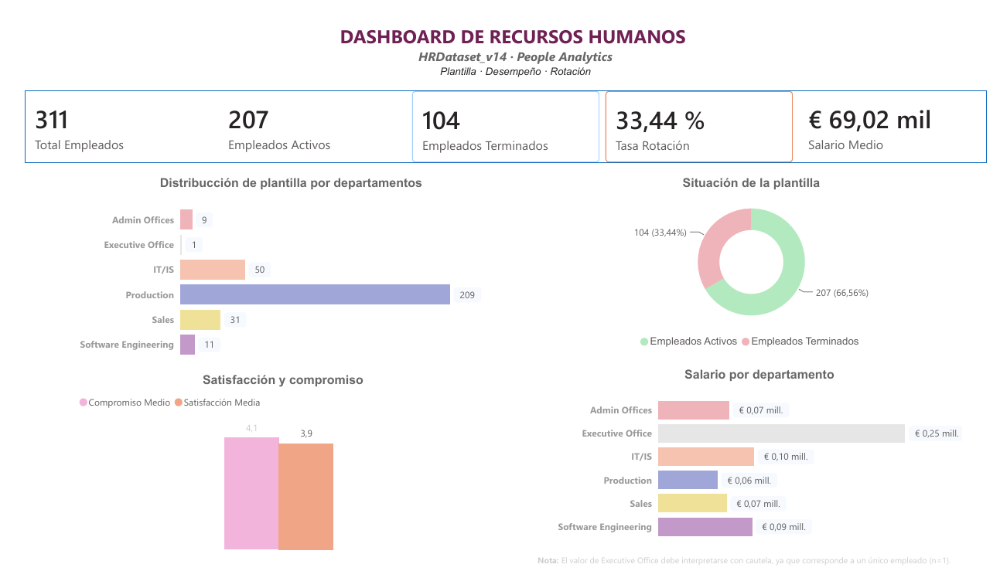
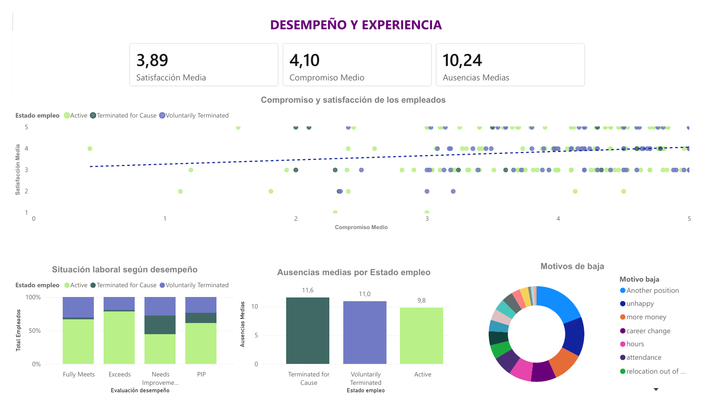
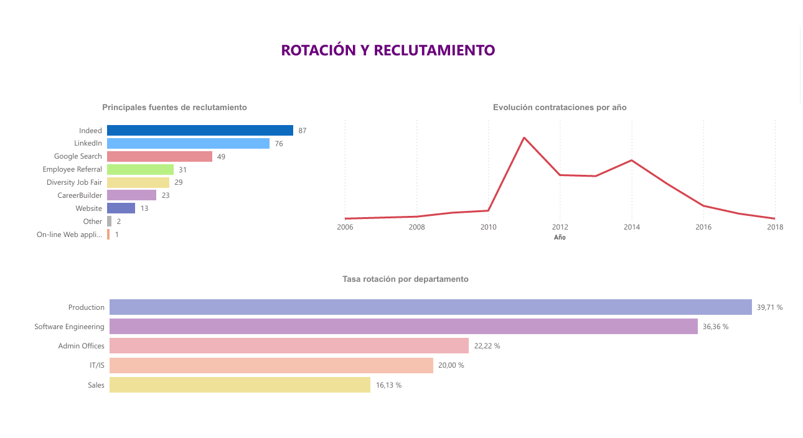
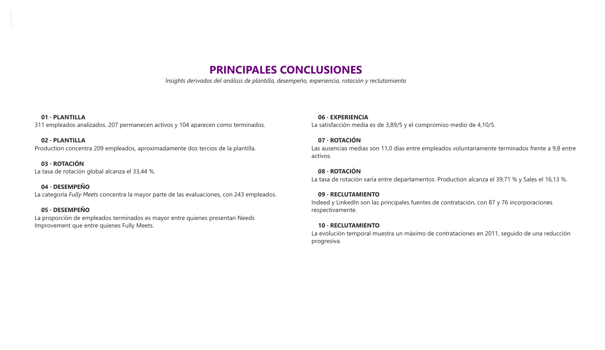

# People Analytics en Power BI

Preparé este informe durante el Máster en People Analytics y Gestión del Talento Digital. Quería reunir en un mismo sitio cuatro preguntas de Recursos Humanos: cómo se compone la plantilla, qué muestran los indicadores de experiencia y desempeño, cómo se distribuye la rotación y qué fuentes aportan más incorporaciones.

## El informe

**Dashboard de RR. HH.** — visión general de la plantilla, el estado laboral, la rotación y algunos indicadores salariales.

**Desempeño y experiencia** — evaluaciones, satisfacción, compromiso, ausencias y motivos de salida.

**Rotación y reclutamiento** — comparación por departamento, fuentes de contratación y evolución anual de las incorporaciones.

**Conclusiones** — síntesis de los resultados y de las preguntas que merece la pena explorar con más datos.

## Algunas cifras

El conjunto reúne 311 registros: 207 aparecen como activos y 104 como terminados. La tasa calculada en el informe es del 33,44 %. Indeed y LinkedIn son las fuentes con más incorporaciones registradas, con 87 y 76 respectivamente.

Son datos descriptivos de esta muestra. No explican por sí solos las causas de la rotación ni representan a una empresa real. También hay grupos pequeños —por ejemplo, Executive Office— cuyas cifras necesitan leerse con cautela.

## Qué trabajé

Organicé el modelo, preparé medidas DAX y elegí visualizaciones para que se pueda recorrer la información por tema. También añadí una página de conclusiones para reunir los principales resultados sin presentarlos como relaciones causales.

**Herramientas:** Power BI Desktop · DAX · modelado de datos · visualización · People Analytics.

## Informe completo

[**Abrir el informe en PDF**](informe-powerbi-rrhh.pdf)

## Datos

Usé HRDataset_v14, un conjunto didáctico sobre una organización ficticia, creado por Rich Huebner y Carla Patalano y publicado en [Kaggle](https://www.kaggle.com/dsv/1572001). La ficha indica licencia [CC BY-NC-ND 4.0](https://creativecommons.org/licenses/by-nc-nd/4.0/).

Este proyecto es académico. Los datos no describen una empresa ni personas reales y no deben utilizarse para tomar decisiones laborales.

---

**Fátima Sánchez Dorado** · Máster en People Analytics y Gestión del Talento Digital
